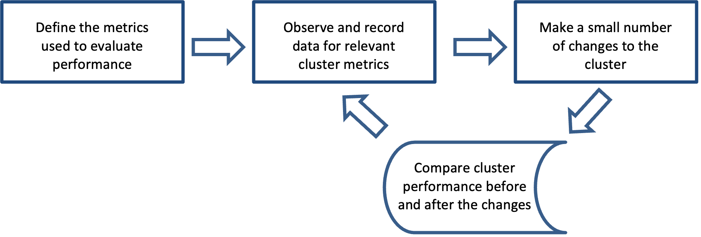
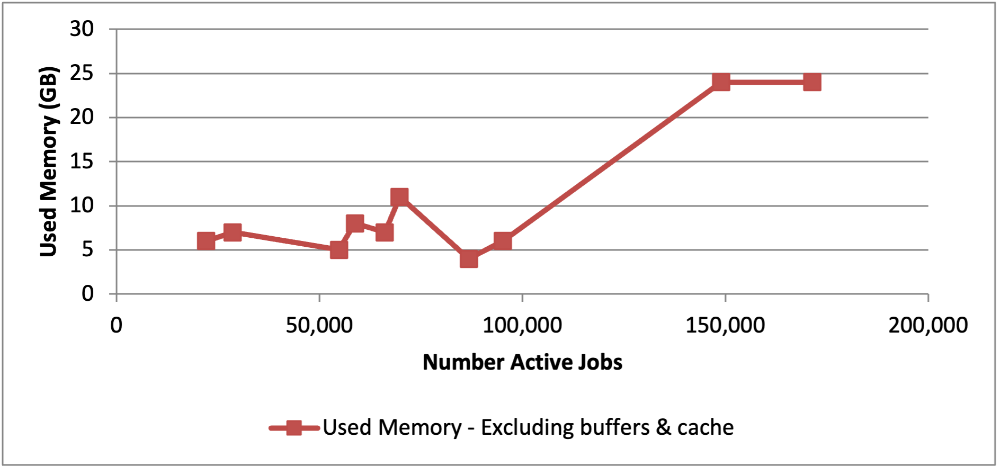
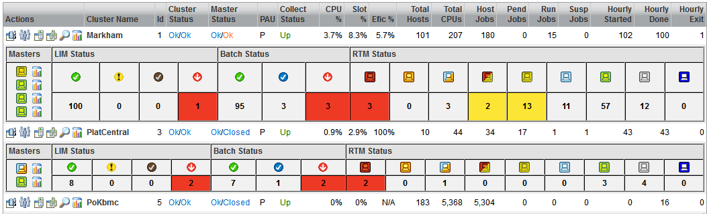
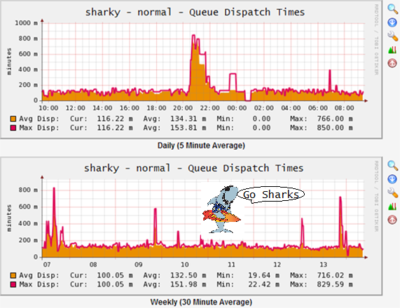

# Large Cluster Best Practices Guide for IBM Spectrum LSF v.10.1 Fix pack 15+

## Table of Contents

- [1. Introduction](#1-introduction)
- [2. Scope](#2-scope)
  - [2.1 IBM Standard Documentation References](#21-ibm-standard-documentation-references)
    - [2.1.1 Active Job Definition](#211-active-job-definition)
- [3. LSF Cluster Tuning](#3-lsf-cluster-tuning)
  - [3.1 LSF Master Infrastructure](#31-lsf-master-infrastructure)
    - [3.1.1 LSF Master (CPU)](#311-lsf-master-cpu)
    - [3.1.2 LSF Master (Memory)](#312-lsf-master-memory)
    - [3.1.3 LSF Master (Storage)](#313-lsf-master-storage)
    - [3.1.4 LSF Master (Network)](#314-lsf-master-network)
    - [3.1.5 LSF Master (Operating System)](#315-lsf-master-operating-system)
    - [3.1.6 DNS / NIS / NFS](#316-dns--nis--nfs)
  - [3.2 LSF Master Tuning](#32-lsf-master-tuning)
    - [3.2.1 LSF Daemons Processor Affinity](#321-lsf-daemons-processor-affinity)
    - [3.2.2 RELAX_JOB_DISPATCH_ORDER](#322-relax_job_dispatch_order)
    - [3.2.3 JOB_INFO_MEMORY_CACHE_SIZE](#323-job_info_memory_cache_size)
    - [3.2.4 Enable independent thread for log file writing](#324-enable-independent-thread-for-log-file-writing)
    - [3.2.5 Job Submission](#325-job-submission)
    - [3.2.6 Handle large number of queries](#326-handle-large-number-of-queries)
    - [3.2.7 Scheduler Tuning](#327-scheduler-tuning)
    - [3.2.8 Other recommendations](#328-other-recommendations)
    - [3.2.9 Cluster Architecture Limits](#329-cluster-architecture-limits)
  - [3.3 LSF Compute Host Tuning](#33-lsf-compute-host-tuning)
    - [3.3.1 LSF_TMPDIR is used for event replay](#331-lsf_tmpdir-is-used-for-event-replay)
    - [3.3.2 LSF Compute Host Processor Affinity](#332-lsf-compute-host-processor-affinity)
    - [3.3.3 Job distribution on a host](#333-job-distribution-on-a-host)
    - [3.3.4 Enable cgroup on Linux](#334-enable-cgroup-on-linux)
  - [3.4 CPU Factor](#34-cpu-factor)
    - [3.4.1 Tuning CPU Factor](#341-tuning-cpu-factor)
    - [3.4.2 CPU Factor Calculation](#342-cpu-factor-calculation)
    - [3.4.3 Synthetic Benchmarks](#343-synthetic-benchmarks)
    - [3.4.4 Bogomips on Linux](#344-bogomips-on-linux)
    - [3.4.5 CPU Factor more info](#345-cpu-factor-more-info)
- [4. Visualization and Monitoring](#4-visualization-and-monitoring)
  - [4.1 LSF Methods](#41-lsf-methods)
  - [4.2 badmin perfmon view](#42-badmin-perfmon-view)
    - [4.2.1 Save job bucket snapshot](#421-save-job-bucket-snapshot)
  - [4.3 badmin showstatus](#43-badmin-showstatus)
    - [4.3.1 Enable mbatchd performance metrics](#431-enable-mbatchd-performance-metrics)
  - [4.4 RTM](#44-rtm)
    - [4.4.1 Queue Dispatch time](#441-queue-dispatch-time)
  - [4.5 IBM LSF Explorer](#45-ibm-lsf-explorer)

## 1. Introduction

Thousands of LSF Clusters are installed, providing best in class work load management across a variety of industries. This guide is targeted towards larger installations with a focus on achieving high job throughput while maintaining the critical services that are required.

Performance itself means different things to different IBM customers. Certain metrics such as slot utilization, license utilization, job throughput per unit time, average wait time, and queue efficiency name only a few metrics which are commonly used.

IBM recommends an iterative closed loop approach to cluster tuning. We recommend each customer attempting to use this guide define the metrics which define performance for them before attempting any performance tuning.

The below diagram shows the process that IBM believes achieves the best performance over time while minimizing risk and adapting to business changes in demand and work methodology. Also, the diagram implies that cluster tuning is an infinite loop. We accept the axiom that for a given workload there is an optimal configuration, but we also accept the reality that workloads are ever changing to adapt to business climates, new technologies, etc. Therefore, cluster tuning or optimization is always a moving target. Only with periodic analysis and configuration updates will a cluster configuration approach optimum over time.



## 2. Scope 

This guide was put together to help customers configure LSF version 10. It assumes a minimum LSF version of v10.1 and incorporates performance enhancements through LSF version 10.1.

The guide is targeted specifically at LSF and includes only minor references to other IBM products. The baseline for the guide is LSF Standard Edition using the standard template, with Electronic Design Automation (EDA) style workload as the presumed job mix. Although guide is written in EDA style workload as baseline, almost all of recommendations can also apply to other high throughput computing cluster environments.

For the purposes of this paper, EDA style workload can be generalized as most jobs in the cluster using a single job slot, a small portion of multi-slot jobs on a single host, and a very few jobs spanning multiple hosts. The clear majority of the jobs are batch oriented, while interactive jobs tend to be among the highest priority jobs in the cluster. Typically, a few percent of the jobs are job arrays, involve dependencies, some jobs require exclusive access to a host, or are preemptive in nature. Most jobs are short, requiring less than 10 minutes of run time to complete, but there also jobs of longer duration that require several hours, a day, to a few weeks to complete. Interactive jobs may be running in the cluster for months.

LSF Standard Edition configuration parameters that are included in the default template are presumed, and generally not included in the discussion.

### 2.1 IBM Standard Documentation References 

- LSF Administrator Guide	“Optimize performance for larger sites”
- LSF Administrator Guide	“Tune UNIX for large clusters”
- LSF Administrator Guide	“Tuning LSF for large cluster”
- LSF Administrator Guide	“Monitor performance metrics in real time”
- LSF Administrator Guide	“Processor binding for LSF job processes”

#### 2.1.1 Active Job Definition 

Active jobs being defined as jobs in memory on the LSF Master, i.e. having a job state of PEND, RUN, PSUSP, SSUSP, USUSP, DONE or EXIT jobs that have not been cleaned. “badmin showstatus” or “bjobs -sum” are two approaches to understand the current number of active jobs.

## 3. LSF Cluster Tuning 

### 3.1 LSF Master Infrastructure 

#### 3.1.1 LSF Master (CPU) 

Based on customer feedback, and the current state of the art in processing power, IBM recommends that clusters which push scalability (i.e. clusters larger than 300 hosts, 4,000 cores or 50K active jobs in the system at any time) run their LSF masters using current POWER or x86_64 processor technology.  If cluster scheduling performance is suffering, upgrading the LSF Master host processing capacities should be one of the first options examined.  Specifically, for the LSF Master, you probably likely will find that the tradeoff of fewer higher performance cores is beneficial as compared to a core heavy / slower speed processor for the LSF Master.  Minimum recommended core count on the LSF Master for large clusters is 12 cores.

#### 3.1.2 LSF Master (Memory)

LSF is memory efficient, and a system with 64GB is usually sufficient for the LSF Master in a cluster with 50K active jobs. The number of active jobs and current query load can have the largest impact on dynamic use of memory in the system.  
`badmin showstatus` or `bjobs -sum` are two approaches to gather the number of active jobs.

`free -g` or `vmstat` can be used to see the amount of free memory in GB.

Reviewing the sample `free -g` output below, there are two rows of information relating to physical memory. In the sample output below, 116GB of used memory includes buffers and cache, and 8GB excluding buffers/cache. Buffers and cached memory remains important to the performance of the system.  The scatter graph plots the 8GB value.

Example output:
```bash
$ free -g
total       used       free     shared    buffers     cached
Mem:           126        116          9          0          0        107
-/+ buffers/cache:          8        117
Swap:           46          0         46
```

**Figure 1 - Scatter graph of active jobs vs. memory used**



To maintain mbatchd stability in high-demand environments, the deployment of the lsfproxyd daemon (rate limiter) is strongly recommended.  This LSF rate limiter daemon acts as a critical gatekeeper by offloading excessive query loads from the mbatchd management daemon, providing essential command buffering and rate-limiting capabilities . The implementation enforces fairness under heavy workloads.  Deployment of the lsfproxyd daemon (rate limiter) is strongly recommended to maintain mbatchd stability, even though it is not enabled by default in 10.1FP15.

#### 3.1.3 LSF Master (Storage)

Typical UNIX based deployments of LSF use a network based file system to store events file for fail over and recovery purpose, e.g. a IBM Spectrum Scale (aka General Parallel File System – GPFS), or a Network File System (NFS). While each file system has its own advantages, what’s crucial for a LSF Master is that read/write access to the files associated with its proper operation (job submission, job clean up and job dispatching) remains responsive. Some file systems, e.g. NFS, can develop a choke point if too heavy a load is put on a filer. Avoid overloading the filer being used by the LSF Master with other I/O intensive applications. The performance expectation is that each file open / read / close should take only a few milliseconds. This requirement extends to any other shared filesystem used for LSB_SHAREDIR in LSF. One of many open source tools to test filer performance is http://www.iozone.org/.

#### 3.1.4 LSF Master (Network)

Faster is better from a networking infrastructure point of view, especially under heavy query load in large cluster. LSF master performance also has dependency on network latency and bandwidth from master host to working storage. When cluster faces heavy query load and LSF master replies a huge amount of data over wire to clients, lots of network bandwidth may be occupied by those query data, which potentially impact LSF master I/O on storage and reduce LSF master response time to client and overall performance.

Current performance trends in modern data centers are moving to 800GbE for spine-leaf architectures, while 200GbE/400GbE are common, and 25GbE remains common for standard server connections.  A LSF Master using a 10GbE/25GbE or better interface, and the infrastructure behind it, is preferred for larger clusters. Small to medium clusters can use a 1G interface. Red Hat Enterprise Linux allows administrators to bind multiple network interfaces together into a single channel using the bonding kernel module and a special network interface called a channel bonding interface. Channel bonding enables two or more network interfaces to act as one, simultaneously increasing the bandwidth and providing redundancy.

#### 3.1.5 LSF Master (Operating System)

IBM has spent significant engineering time optimizing LSF master behavior on Linux. Linux has matured enough to be an enterprise class operating system in terms of reliability and will leverage today’s fastest commodity processing units.

Much of this guide is only applicable to Master candidates running on a Linux OS. So, IBM recommends using reasonably current version 64 bit Linux.  While other distributions are suitable, Red Hat Enterprise edition predominates.

##### 3.1.5.1 Tune /etc/sysctl.conf

Check the following setting in /etc/sysctl.conf on master and master candidate hosts

Based on best practices for high-performance computing (HPC) and workload management, the following settings are typically applied to LSF management nodes and execution hosts.  Add or update these parameters in /etc/sysctl.conf or as a new file in /etc/sysctl.d/99-lsf.con

```conf
#Set swapiness to at most 10 percent
vm.swappiness=10

#No hugepages**
vm.nr_hugepages=0

#Network read memory buffer size
net.core.rmem_default=262144

#Network write memory buffer size
net.core.wmem_default=262144

#Fast socket close and reuse
net.ipv4.tcp_fin_timeout = 5

#Increase the number of incoming connections.
# LSF 10+ uses a nailed-up connection to each host & client in the cluster.
net.core.somaxconn = 8000
```

#### 3.1.6 DNS / NIS / NFS

DNS affects LSF master daemon startup time and reconfiguration time. The performance expectation for infrastructure is that DNS can respond within a few milliseconds. It should be noted that the Name Service Cache Daemon (nscd) has been employed with improved performance results for both host lookup and authentication lookup in NIS environments.

NIS (for those customers who use it) affects daemon startup time and job run time. The performance expectation is each user lookup should take only a few milliseconds. The performance should be the same for other authentication methods.

There are several tests available in the open source community for testing the performance of these types of infrastructure:

DNS Performance test: http://www.swmirror.org/drupal/?q=node/91

### 3.2 LSF Master Tuning

#### 3.2.1 LSF Daemons Processor Affinity

LSF is designed to support a wide variety of Operating Systems types, versions, processor technology.  The LSF Master and master candidates are best limited to a “certified” setup.  The following discussion is appropriate for customers who run their LSF master on a “Certified”  e.g. Linux x64 kernel matching glibc version. (e.g. RHEL 9, kernel 5.14, glibc 2.34 | RHEL 10, kernel 6.12, glibc 2.39 ).

Setting processor affinity on the LSF Master, along with effective policy and priority settings, can help to achieve the maximum possible performance. Applications will always need to compete for resources, with other processes.

Systems that perform multitasking are naturally more prone to indeterminism. Even high priority applications might eventually be forced to wait while another application leaves a critical area to be preempted. Additionally, migrating processes from one CPU to another can be costly due to cache invalidation.

##### 3.2.1.1 Understanding LSF Daemons processes on Master

The two most CPU intensive LSF related daemons on the master host are mbatchd and, with lim being the next most intensive daemon on the master host. The mbschd daemon is the scheduler process. In LSF standard edition, the primary mbschd processing architecture is a single threaded flow.  Areas of the scheduler outside of the primary scheduling flow run in a separate process, e.g. pending reason update.

The master mbatchd related functionalities are spread across several mbatchd child processes. These child processes are spawned to provide support services where appropriate. For instance, mbatchd will spawn a child mbatchd process to handle all client queries. The query child process is multi-thread, using one thread per query request (bjobs, bhosts, bqueues etc). The “badmin mbdrestart –p” will fork a child mbatchd process to handle LSF mbatchd daemon restart request and help minimize downtime for LSF. If MIN_SWITCH_PERIOD is configured, in lsb.params, to a value of 600 or greater, mbatchd will fork a child process that handles event switching, thereby reducing the load on mbatchd and greatly improve daemon response time for client requests. The mbatchd daemon will also spawn a child process to do job file cleanup periodically.  RUNTIME_LOG_INTERVAL defines the interval for mbd to fork a child to log the pending and running jobs, to support IBM Analytics data collection.

##### 3.2.1.2 Automated LSF Daemons CPU binding configuration

LSF supports automated CPU process binding which forces a process to reside on a processor/core.  Setting LSF_INTELLIGENT_CPU_BIND=Y in lsf.conf will bind the most critical portions of mbatchd, mbschd and lim.

The binding used can be seen in file $LSF_ENVDIR/cpu_binding/<hostname>.<cluster name>.

One advantage that automated processor binding provides is that the settings are appropriate for each LSF Master Candidate, and do not assume that all LSF Master candidates have similar processor core counts and core numbering.

The `lim -T` command can be used on the LSF Master(s) to understand which cores are on which processor.

Linux does provide a way to restrict a processor core to restrict use to only processes which are specifically bound to the core by setting the kernel parameter "isolcpus=<CPU_ID>" to the boot loader during boot or GRUB configuration file.

##### 3.2.1.3 Sample Processor utilization tools

Refer to the local Operating System documentation for a complete list.

**Monitor Core Utilization**

Processor utilization on a core at a moment in time isn’t very interesting, rather its utilization over a duration that is of interest.  For example, utilization of more than 80% (idle < 20%) over duration of 10 seconds for any single core is cause for further analysis.  Likewise, is utilization of more than 70% (idle < 30%) over duration of 10 minutes.

Example:  Displays CPU usage for cores 8-10 with a duration of 10 seconds for 5 iterations.
```bash
sar 8,9,10 10 5    # Take note if %idle < 20.00
```
Example:  Displays CPU usage broken down by all cores for the current day.
```bash
sar -P ALL         # %idle < 30.00 for a 10-minute duration
```
Example:  Displays CPU usage broken down by all cores for yesterday.
```bash
sar -P ALL -f /var/log/sa/sa$(date +%d -d yesterday)
```
**Validate processor binding**

Review current affinity and thread related configuration values.

For LSF master processes run:
```bash
badmin showconf mbd | egrep 'CPUS|THREADS'  #lim, mbatchd:mbsched
bparams -a |grep 'CPUS|THREADS' #child mbatchd
taskset --cpu-list --pid <PID>
```
Alternative form
```bash
taskset --cpu-list --pid `pgrep -o lim`  2>/dev/null
taskset --cpu-list --pid `pgrep -o mbatchd`  2>/dev/null
taskset --cpu-list --pid `pgrep -o mbschd` 2>/dev/null
```

#### 3.2.2 RELAX_JOB_DISPATCH_ORDER

LSF can allow multiple jobs with common resource requirements to run consecutively on the same allocation. Whenever a job finishes, LSF attempts to quickly replace it with a pending job that has the same resource requirements. To ensure that limits are not violated, LSF selects pending jobs that belong to the same user and have other attributes in common.

To enable LSF to reuse the resource allocation, specify the `RELAX_JOB_DISPATCH_ORDER = ALLOC_REUSE_DURATION[5,30]` parameter either cluster wide in the `lsb.params` file, or on a per queue basis in `lsb.queues`.  If set in both `lsb.params` and on individual queues in `lsb.queues`, the queue level settings take precedence.  As such you can enable the functionality at the cluster level and selectively disable, or change the `ALLOC_REUSE_DURATION` on a per queue basis.  Jobs are chosen for allocation reuse based on submission time instead of other factors, e.g. `btop`.

The functionality is not extended to all job buckets; the significant exclusions include:
- Interactive jobs
- Jobs that span multiple hosts
- Jobs with compute unit (CU) requirements
- Advanced Reservation related jobs

#### 3.2.3 JOB_INFO_MEMORY_CACHE_SIZE

The jobinfo cache reduces the load on the work directory filer by caching job information such as the job's environment variables, command-line and eexec data in memory, in a compressed format. The jobinfo cache is part of mbatchd memory.  `JOB_INFO_MEMORY_CACHE_SIZE=1024` will allocate 1024 MB (1G), and enable new job information to be stored in the new event file instead of individual job files.  As jobs are cleaned from the system, the `lsb.jobinfo.events` event file needs to be periodically rewritten to discard the unneeded data. By default, the job information event file is rewritten every 15 minutes. This interval can be changed with the parameter `JOB_INFO_EVENT_DUMP_INTERVAL`.  If the cache fills up or during periods when the cache is being rewritten, the pre-LSF 10 behavior or individual jobs files is used.  Monitor usage via `badmin showstatus` to see usage, and bump the size in 100MB increments if needed.

#### 3.2.4 Enable independent thread for log file writing

Set `LSF_LOG_QUEUE_SIZE = 100000` and `LSF_DISCARD_LOG=Y`.  Discard additional log messages if the log queue reaches `LSF_LOG_QUEUE_SIZE` lower than `LOG_WARNING` level and log a summary message later.

##### 3.2.4.1 MAX_INFO_DIRS

Strongly recommended to set `JOB_INFO_MEMORY_CACHE_SIZE`, which reduces but does not eliminate the benefit of setting `MAX_INFO_DIRS`.  The `MAX_INFO_DIRS` parameter is configured in the `lsb.params` file.  There is no performance penalty by having many subdirectories.  The recommended setting is `MAX_INFO_DIRS=500`.

##### 3.2.4.2 LSB_JOBINFO_DIR

Job file I/O operations may impact cluster performance when there are large number of jobs in a LSF cluster. You can configure `LSB_JOBINFO_DIR` on high performance I/O file systems to improve cluster performance. LSF will access the directory to get the job information files.

Warning:  Changing `LSB_JOBINFO_DIR` must be done in a very controlled fashion.  See the section "Change job information directory for a running cluster" for exact details.

#### 3.2.5 Job Submission

##### 3.2.5.1 Pack Job Submission

The `bsub -pack` option is designed to speed up the submission of many jobs from single user when the feature is enabled, you can submit jobs by submitting a single file containing multiple job requests. While group of jobs are submitted as a block of jobs to mbatchd, each job is processed individually, and can have separate bsub parameters. Use the job packs feature to submit multiple jobs to mbatchd at once, instead of submitting the jobs individually, it minimizes system overhead and improves the overall job submission rate dramatically.

There are a few restrictions around bsub related parameters, mostly having to deal with interactive jobs. See `bsub –pack` for more details.

To enable the functionality, configure `LSB_MAX_PACK_JOBS=<integer>` in `lsf.conf`. The recommended number is `300`.

##### 3.2.5.2 Job Submission via script

Many customers running LSF have users submitting jobs automatically via scripts. These scripts often require that the jobs they submit be accepted without messages like “batch system not responding” and the like.

To get rid of these feedback messages set the following in `lsf.conf`:
```bash
LSB_MBD_DOWN_MSG=""
LSB_MBD_BUSY_MSG=""
LSB_MBD_CONNECT_FAIL_MSG=""
```
An alternate approach is to set the documented environmental variable `BSUB_QUIET`.

#### 3.2.6 Handle large number of queries

In a busy production cluster, users often issue many query requests to LSF to check system and their jobs status. These query requests may generate heavy load on both master host and network, which potentially impact overall LSF system performance. Significant architectural changes were delivered as part of LSF 10.1+ to reduce overall impact.

##### 3.2.6.1 Mbatchd multi-thread query

By default, LSF mbatchd spawns a child process for every query request (bjobs, bhosts, bqueues etc). When LSF holds many active jobs or LSF mbatchd memory foot print is very large (a few Gbytes), it becomes relatively slow to spawn a child process to handle query request. To improve user query response time and reduce impact on LSF master, it is recommended to enable Multi-thread query mode. Under multi-thread query mode, instead of spawning a child process for every query request, a query mbatchd will be spawned periodically and listen on a query listening port (`LSB_QUERY_PORT`). And query mbatchd creates thread for each query request (bjobs, bhosts, bqueues etc).

To enable this feature, you need to define `LSB_QUERY_PORT=<port number>` in lsf.conf and restart mbatchd. `LSB_QUERY_PORT` along only enables multi-thread job query (bjobs). To enable all other mbatchd queries (except bread, bstatus and tspeek), also define `LSB_QUERY_ENH=Y` in lsf.conf.

Multi-thread query mode can greatly improve user response time; however, because the query mbatchd is spawned periodically, the information returned may be slightly out of date. `MBD_REFRESH_TIME` parameter in lsb.params can be used to fine tune the update interval. The default update interval is 10 seconds. It is recommended not to set value too low to avoid introducing too much overhead on LSF master.

##### 3.2.6.2 mbatchd child query load minimization

In large clusters querying can be a much higher load than the scheduling of jobs. You can limit the number of concurrent query requests using the parameter `MAX_CONCURRENT_QUERY` in lsb.params.

This maximum is a per-thread maximum if `MBD_QUERY_PORT` is enabled (which enables multi-threaded MBATCHD). Thus, the maximum becomes the number of mbatchd child processes times the `MAX_CONCURRENT_QUERY`.

When an MBATCHD gets more queries than the `MAX_CONCURRENT_ QUERY` allows, the queries exceeding the limit are blocked until the child processes of mbatchd are free enough to respond to their request.

Recommended value for this parameter depends on:

The average number of simultaneous queries hitting mbatchd

Whether multithreaded MBATCHD is enabled

And the number of cores the MBATCHD child processes is bound to

Generally, for a multithreaded MBATCHD environment
```text
MCJQ = AQR / NCPB
```
where
```text
MCJQ = MAX_CONCURRENT_ QUERY
AQR = average query rate (see visualization section below to view the query rate)
NCPB = number of cores bound for MBATCHD queries
```
Note:   Default is no limit.

##### 3.2.6.3 Analyze query load

If query load is high, you can enable query diagnosis to get a detailed view of the load, with a goal of devising better approaches.

Enable query diagnosis for 10 minutes:
```bash
badmin diagnose -c query -f /tmp/queryload -d 10
Dynamic query diagnosis started and will last 10 minutes.
```
LSF provides the following fields for each query request:

- Time stamp: time LSF handled the request
- Command: LSF commands (API maps to a command)
- User: who issued the request
- Host: where the request issued
- Data Size: how many kilobytes were returned to the client
- Command options: reported as a bitmask.

Look for large numbers of queries from a single host or user.  Look at the volume of data being returned by a query.

##### 3.2.6.4 Reduce network traffic

To get active job information from the system, lots of users use bjobs –l or bjobs –UF in the script to fetch and parse the output. When LSF holds a large amount of active jobs in its memory, this approach will generate huge network traffic. For instance, in one of production clusters, it measures LSF mbatchd sends 4 G bit / second over the wire in peak time on 10 G network. In a 1 G network cluster, this type of query load will significantly impact overall cluster performance. LSF offers several better ways to reduce query load, but still get accurate information for job. End users should be educated to use those instead.

bjobs –o field_list outputs only the specified data fields in a format that can be more easily parsed by scripts. Compared to the default bjobs –l output, which sends all job information back to the client, using bjobs –o can save unnecessary network traffic. For example,
```bash
% bjobs -o "jobid stat queue job_group delimiter='|'" 3
        JOBID|STAT|QUEUE|JOB_GROUP
        3|RUN|low_normal|/myproj/user1
```
Use badmin showstatus to show cluster summary information, compared with a script that runs bjobs –u all, bqueues and bhosts to get same data.

Use bjobs –sum to summarize job user information. For example:
```bash
% bjobs –u user1 –q regression –sum
RUN  SSUSP USUSP UNKNOWN  PEND  FWD_PEND
0    0     0     0        6403  9   0
```

##### 3.2.6.5 Master LIM load minimization

To decrease the load on the master host, LSF_SERVER_HOSTS in lsf.conf should be defined such that the primary LSF Master is last in the list. A best practice is to use the inverse order of LSF_MASTER_LIST. If you have two of fewer hosts in the list, consider prepending the LSF_SERVER_HOSTS list with a couple LSF Servers.

```bash
LSF_MASTER_LIST="lsf_master1 lsf_master2 lsf_master3"
LSF_SERVER_HOSTS="lsf_master3 lsf_master2 lsf_master1"
```

```bash
LSF_MASTER_LIST="lsf_master1 lsf_master2"
LSF_SERVER_HOSTS="lsf_server1 lsf_server2 lsf_master2 lsf_master1"
```

#### 3.2.7 Scheduler Tuning

##### 3.2.7.1 Reduce number of “buckets”

Jobs that share attributes in common are grouped into "buckets" for scheduling. In many cases, if one job in a scheduling bucket cannot be dispatched due to lack of resources, then LSF is able to infer that the remaining jobs in the same bucket cannot be dispatched either. Using buckets in this way helps to reduce the search space, leading to better performance of the scheduler.  Refer to section 4.2 to see the number of job buckets in the system.

Job submission attributes that determine whether two jobs can reside in the same bucket include:

- queue (-q)
- user
- number of tasks (-n)
- resource requirement expression (-R)
- advance reservation (-U)
- set of hosts requested by the job (-m)
- service class name (-sla)
- exclusivity (-x)
- fairshare user group (-G)
- project name (-P)
- runtime limit and estimated runtime (-W, -We)

In general, fewer buckets mean better scheduler performance. The administrator can help to reduce the number of buckets by reducing the number of different values for these job attributes that are admitted to the system.

LSF provides the ability to save a snapshot of the current contents of the scheduler buckets to help administrators diagnose problems with the scheduler, via  badmin diagnose -c jobreq

Of importance is the resource requirement expression. For example, the following two jobs with different memory requirements will end up in different scheduling buckets.
```bash
bsub -R "rusage[mem=1000]" ./a.out
bsub -R "rusage[mem=1001]" ./a.out
```
To avoid generating too many buckets, it is recommended that administrators control the number of different resource requirement strings in the system.

One way to achieve this is by setting up resource requirements in application profiles. Have users submit to those application profiles, instead of specifying the resource requirements themselves. (This can alternatively be done at the queue level.)  An esub can be used to prevent jobs from specifying resource requirements (-R) in the job submission.

Another approach is to allow users to specify -R, but to have an esub modify job resource requirements at submission time.  To do this, first decide on an allowable set of memory requirements. Then create an esub script that rounds each job's memory requirement up to the nearest element of the set.

A similar approach can be used to reduce the number of distinct projects (-P), host requirements (-m), and runtimes (-W, -We).

##### 3.2.7.2 Strict Resource Requirement Parser

In each scheduling cycle, LSF scheduler will match job resource requirement with candidate hosts. One of most CPU intensive steps is to evaluate job resource requirement select clause. By default, LSF scheduler uses TCL parser and evaluator. Our in-house test shows more than 10 times performance improvement over TCL parser and evaluator. We highly recommend customers to enable it in production. To enable strict parser, the site needs to define LSF_STRICT_RESREQ=Y in lsf.conf, then restart all LSF daemons in the cluster. This has been set to the default out of box configuration for fresh installed cluster.

##### 3.2.7.3 MultiCluster Scheduling support

There are use cases where the benefit of a MultiCluster environment is high.  E.g. enterprise wide build that involves a coordinated job flow that spans different geographically dispersed clusters.  Other examples allow for follow the sun use of resources. Most sites don’t interact with other LSF clusters.  The LSF MultiCluster scheduling module is enabled by default.  To disable the functionality, simply prepend a comment to the schmod_mc entry in lsb.modules.

##### 3.2.7.4 Scheduling performance and preemption

Many clusters are large enough to avoid the need for a preemptive scheduling policy. In other cases, preemption is valuable, but some applications either do not tolerate suspend and resume actions or their use (e.g. interactive GUIs) make preemption more problematic than the value it brings.

In such cases it is possible to disable the preemption plug-in entirely and thereby short circuit the time spent in the scheduler considering preemption even if there are no scheduling policies that involve preemption.  To remove the preemption plug-in, simply prepend a comment to the "schmod_preemption" line in the lsb.modules file.

There are additional scheduling optimizations which come into play if preemption isn’t configured, which allows removal of closed_Full hosts from consideration for the job during the scheduling cycle if either the preemption plugin is not loaded, or the queue isn’t preemptive.

##### 3.2.7.5 Delay before triggering a preemption

Preemption is one of the most expensive scheduling policies. In many cases, when the low priority jobs are very short, if high priority jobs can wait a while for the low priority jobs finish, the preemption can be omitted, and cluster performance can be improved. Enable the cluster wide functionality by setting `LSB_PREEMPT_DELAY=<integer>` in `lsf.conf` or `PREEMPT_DELAY` parameters in either queue level or application profile level. Recommended initial setting: `LSB_PREEMPT_DELAY=30` for cluster wide or `PREEMPT_DELAY=30` per application or per queue basis.

Preemptive pending jobs wait for a specific time in seconds after submission. Before the time expires, preemption will not be triggered, but the job can be dispatched by other policy scheduling. After the time expires, if the job is still pending, the preemption will be trigged.

The waiting time is for preemptive jobs in the pending status only. It will not impact on the preemptive jobs that are suspended.

The time is counted from the submission time of the jobs. The submission time means the time mbatchd accepts a job, which includes newly submitted jobs, restarted jobs (by brestart) or forwarded jobs from a remote cluster.

When the preemptive job is waiting, the pending reason is "The preemptive job is allowing a grace period before preemption."

##### 3.2.7.6 Short Job Scheduling

The latency associated with the scheduler in LSF for jobs running more than five minutes is small enough that most customers don't notice it. As hardware gets faster and faster, the average job runtime is getting shorter and shorter. Shorter jobs also have a compounding effect on LSF in that they cause more scheduling load as the number of free slots per cycle increases.  An analysis of some very large high throughput sites, shows that more than half of the jobs complete in less than 30 seconds.  In such cases, the latency of the scheduler to launch jobs is of the same order as the job duration and slot utilization suffers.  Use of `RELAX_JOB_DISPATCH_ORDER = ALLOC_REUSE_DURATION[5,30]` should be the first approach considered.

##### 3.2.7.7 Fast Turnaround for Low Latency Jobs

In a production cluster, there are typically two types of jobs, batch and interactive/low latency jobs. Expectations differ on how quickly these jobs are launched following submission.  Since batch jobs are majority of workloads, the primary focus is to improve resource utilization and throughput. For low latency jobs, end users expect near immediate job dispatch.  Tips when setting up low latency workloads:

- Define high priority queue for interactive jobs

Scheduler goes through queues based on priority. Workloads in high priority queue will have higher chance to get dispatched compared with rest of workloads. If there are no dedicated resources for interactive jobs, define interactive queue priority as high as possible to easily gain the access of idle resources.

- Dedicated resource for interactive jobs

When there is high contention on the common resources and low priority batch jobs typically take longer time to complete, to guarantee quick turnaround time for interactive jobs, site may consider reserving some of dedicated resources for interactive jobs. This can be achieved by several ways: 1) dedicated host group only assigned for interactive high priority queue; 2) dedicated guarantee resource pool for interactive high priority queue with some loan policies to allow others queues to take resources etc.

- DISPATCH_BY_QUEUE

By default, LSF scheduler will only dispatch jobs after finishing one scheduling cycle. This will reduce communication overhead between LSF daemons. However, the drawback is, if scheduler hits a very long scheduling cycle, those high priority urgent jobs must wait till the end of cycle before they can be dispatched.

This behavior can be changed by `DISPATCH_BY_QUEUE=Y` in each queue level. Once this parameter is configured, scheduler will dispatch those jobs after completing scheduling for queue with parameter defined. It is recommended to configure `DISPATCH_BY_QUEUE=Y` for high priority interactive job queues to improve job turnaround time.

##### 3.2.7.8 Limiting use of Resource Reservation

Resource reservation policy can be used to help resolving job starvation challenge when jobs require scarce resources. Resource reservation policy is controlled by setting `RESOURCE_RESERVE` parameter in `lsb.queues`.

However, resource reservation is an expensive scheduling policy compared with regular dispatch scheduling. Judicious use of the capability would be to enable for those few cases larger jobs are being starved, and after exploring alternative approaches that would achieve the same desired results.

##### 3.2.7.9 Order statement in RESREQ

The keywords `slots` and `maxslots` are available for use in the order portion of a resource requirement string. This order can also be set at the cluster level, queue level or application profile level by setting `DEFAULT_RESREQ_ORDER` parameter in `lsb.params` or `RESREQ` in `lsb.applications` or `lsb.queues`.  For example, you can pack jobs onto hosts with the fewest free slots by setting `DEFAULT_RESREQ_ORDER=-slots:-maxslots`. This will dispatch jobs to the host with the fewest free slots and secondly to hosts with the smallest number of jobs slots defined (`MXJ`). This will leave larger blocks of free slots on the hosts with larger `MXJ` (if the slot utilization in the cluster is not too high).  Having the scheduler pack smaller slot jobs onto hosts with fewer free job slots will tend to improve both dispatch and utilization of parallel jobs that run in the cluster.

### 3.2.8 Other recommendations

##### 3.2.8.1 Dynamic Host Support removal

If Dynamic Hosts are not used in a cluster, the housekeeping effort that mbatchd goes through to detect and remove non-functioning Dynamic Hosts can be disabled. To disabled, comment out the `LSF_DYNAMIC_HOST_TIMEOUT` entry from `lsf.conf`, indicating why the parameter is being disabled.

### 3.2.8.2 JOB_SPOOL_DIR

If `JOB_SPOOL_DIR` is not configured, LSF uses `$HOME/.lsbatch` as the default job spool directory on UNIX/Linux systems. Job-related temporary data, including buffered standard output and standard error, can therefore generate significant filesystem I/O and metadata activity on users' home filesystems, particularly in environments with high job throughput.

As a best practice, configure `JOB_SPOOL_DIR` in `lsb.params` to use a high-performance, scalable filesystem rather than relying on users' home directories.

In addition, **avoid using a single flat spool directory for large or high-throughput clusters**. LSF supports dynamic patterns in `JOB_SPOOL_DIR`, including `%U` for user and `%H` for the first execution host. At a minimum, consider separating spool data by user:

```text
JOB_SPOOL_DIR=/lsf_spool/%U
```

This distributes spool files across per-user directories rather than allowing all jobs to create files within one directory.

For very large clusters, or environments with exceptionally high job throughput, consider further distributing the files by both user and execution host:

```text
JOB_SPOOL_DIR=/lsf_spool/%U/%H
```

Alternatively, `%H/%U` can be used where isolating filesystem activity first by execution host better suits the site's operational model.

**Including `%U` also has a permissions advantage.** When `%U` is the first dynamic pattern, LSF creates the `%U` directory and subsequent directories with `700` permissions. If `%U` is omitted or is not the first dynamic pattern, LSF creates the dynamically generated subdirectories with `777` permissions. This makes `%U/%H` particularly attractive where both filesystem scalability and user-level isolation are important considerations.

LSF normally removes temporary files and directories under `JOB_SPOOL_DIR` after a job finishes. However, administrators should **periodically monitor the spool filesystem for stale files and unusually large directory or inode counts**. If stale spool files accumulate because of abnormal conditions, they should be investigated and safely cleaned up. Before deleting files, verify that the associated jobs are no longer active; file age alone should not be used to determine whether a spool file can safely be removed.

> **Best Practice:** Use a scalable filesystem for `JOB_SPOOL_DIR`, use at least `%U` to distribute spool files across directories, and consider `%U/%H` for very large or high-throughput environments. Monitor spool-directory file/inode counts and remove confirmed stale files when necessary.

```text
badmin reconfig
```

After changing JOB_SPOOL_DIR in lsb.params, run the following command to reload the configuration and make the change effective:

Alternatively, restarting mbatchd with badmin mbdrestart also reloads the configuration. Jobs that are already running are not affected by the change and continue to use their existing spool directory. The updated JOB_SPOOL_DIR applies to subsequent jobs.

##### 3.2.8.3 MBATCHD improve job array handling

You can improve mbatchd performance on operations for job arrays or elements by enabling `JOB_ARRAY_EVENTS_COMBINE=Y` in `lsb.params`.

##### 3.2.8.4 Limit job requeue

Automatic job requeue can be set at the queue or application profile level.  Once enabled, by default, mbatchd will requeue a job automatically up to 2 billion times before suspending the job. The recommendation is to tune LSF to only requeue the job a few times before suspending the job.  The job requeue limit can be set cluster wide (`lsb.params`), on an individual queue level (`lsb.queues`) or at the application profile level (`lsb.applications`).  Set `MAX_JOB_REQUEUE=<integer>`, e.g. `MAX_JOB_REQUEUE=3` or `5`.

##### 3.2.8.5 Enforce User Group Tree

When `ENFORCE_UG_TREE=Y` is defined in `lsb.params`, user groups must form a tree-like structure, with each user group having at most one parent. User group definitions in the UserGroup section of `lsb.users` will be checked in configuration order, and any user group appearing in `GROUP_MEMBER` more than once will be ignored after the first occurrence.

##### 3.2.8.6 No job slots on the LSF Master

Update the `MXJ` value for the LSF Master in the `lsb.hosts` file and set the `MXJ` value to `0`.  Consider doing the same for the LSF Master Candidates in case of failover.  Perhaps a more pragmatic approach is to allow at least some lighter weight jobs to run on the LSF Master Candidates, and in case of failover, quickly close the host with `badmin hclose`.

##### 3.2.8.7 Limit job dependency evaluation

Typically, only a few percent of all pending jobs involve job dependency. You can limit the scheduling load of dependency related jobs by setting `EVALUATE_JOB_DEPENDENCY=integer` in `lsb.params`. The job dependency evaluation resumes from the stopping point in the next scheduling cycle. Once every 10 minutes the complete job list is evaluated for dependencies regardless of the `EVALUATE_JOB_DEPENDENCY` setting.  `EVALUATE_JOB_DEPENDENCY_TIMEOUT=integer` (in msec) provides an explicit time limit on how long mbatchd spends evaluating job dependencies in a single scheduling cycle.  If both `EVALUATE_JOB_DEPENDENCY_TIMEOUT` and `EVALUATE_JOB_DEPENDENCY` are set, `EVALUATE_JOB_DEPENDENCY_TIMEOUT` is used, and `EVALUATE_JOB_DEPENDENCY` is ignored.

To improve overall scheduling performance, you want to set one or the other of these parameters sufficiently small as to avoid evaluating all dependency jobs every scheduling cycle.   The recommendation is to tune this value to 30% of the average number of pending dependency related jobs. Use the lightweight `bjobs –o` command to determine current number of pending jobs.

```bash
bjobs -u all -o "jobid dependency" | wc -l
```

##### 3.2.8.8 Limit pre-exec retries

Multi-cluster related. Set `LOCAL_MAX_PREEXEC_RETRY=3` in `lsb.params`.

The maximum number of times to attempt the pre-execution command of a job on the local cluster.

#### 3.2.9 Cluster Architecture Limits

LSF is very flexible and can be configured in a variety of ways to support the business needs of the cluster. Different sets of configuration items support different business goals and there are cases where expanding use of one set of capabilities can impact cluster performance, or throughput.

Large clusters can be configured in such a way to support the completing goals of responsiveness, end user flexibility, while also maximizing utilization of resources in the cluster.

##### 3.2.10.1 Limit Queue sprawl

The primary purposes of a queue is to define job priority, scheduling approach, and define major business functionality around whether the queue can be used for Interactive Jobs, Batch Jobs or Both. Other major queue based functionality includes preemption (supported or not, preemptable, preemptive), Job Starter Support, Job Controls, etc. Use of application profiles, Guaranteed SLA, esub and limits can be leveraged to provide the critical business services for different groups of users on a single queue. Best practice is to limit the number of queues, and only have additional queues if required. While LSF can support hundreds of queues, best practice is to limit the number of queues to 20, perhaps growing to 30 if required by critical business drivers.

##### 3.2.10.2 Limit number of active jobs

A single LSF cluster can support up to hundreds of thousands pending jobs. However, the more jobs in the system, the more resident memory LSF will consume on the master host and the more complexity it will impose on Job scheduler. If site experiences cluster response slowing down due to a huge number of pending jobs in the system, you may consider reducing total number of jobs in the system.

For number of pending jobs, LSF offers several ways to not only control maximum number of pending jobs, but also control maximum number of pending jobs per user or user group. Cluster wide pending job limit can be configured in `MAX_PEND_JOBS` in `lsb.params`, while per user or user group pending job limit can be configured by `MAX_PEND_JOBS` parameter in "Users" section of `lsb.users` file.

`MAX_PEND_SLOTS` can be configured in a similar manner to limit the maximum number of jobs slots.

When jobs complete (`DONE` or `EXIT`), LSF will keep those jobs in mbatchd memory till job clean period. The larger clean period value is, the more jobs LSF will have to keep in its memory. Job clean period is controlled by `CLEAN_PERIOD` parameter in `lsb.params`. In a high throughput cluster, it is recommended to set `CLEAN_PERIOD` as a smaller value, say `3600` (1 hour).

##### 3.2.10.3 Limit number of historical event files

LSF uses the `lsb.events` file to keep track of the state of all jobs. LSF system keeps track of everything that is associated with the job in the `lsb.events` file.  On startup or when the `lsb.events` file exceeds a configured size or age, the events file is automatically trimmed and old job events are stored in `lsb.events.n` files. The CPU time required to roll the event files increases as the number of files increases.  It is recommended to maintain 3 weeks' worth of `lsb.events.xxx` files under LSF working directory.  Excess files should be archived outside of `$LSB_SHAREDIR`.

##### 3.2.10.4 Limit number of historical accounting files

LSF uses the `lsb.acct` file to keep track of accounting related information for all finished jobs (with a `DONE` or `EXIT` status) jobs.  By default, the `lsb.acct` file will grow without bound.  `lsb.params` parameters to enable automatic archiving include `ACCT_ARCHIVE_AGE`, `ACCT_ARCHIVE_SIZE`, and `ACCT_ARCHIVE_TIME`.  `MAX_ACCT_ARCHIVE_FILE` is related.

Suggested initial values:

```bash
ACCT_ARCHIVE_AGE=30              # 30 days
ACCT_ARCHIVE_SIZE=500000         # 500 MB
MAX_ACCT_ARCHIVE_FILE=10         # 10 months or 5 GB, whichever comes first
```

### 3.3 LSF Compute Host Tuning

#### 3.3.1 LSF_TMPDIR is used for event replay

On execution hosts, the sbatchd daemons write their events to a file under LSF_TMPDIR (the default directory is /tmp). If the LSF temporary directory becomes full, sbatchd cannot write to its event file, and the daemons do not recover normally. You must make sure to maintain free space in the LSF_TMPDIR directory.  The replay mechanism needs are slight, with 50K bytes being sufficient.

#### 3.3.2 LSF Compute Host Processor Affinity

CPU binding is not only good for improving performance of LSF daemons. Binding can be employed to force a job running on a single host to bind to particular cores as well to make use of cache coherence and low memory access latency if selected core is close to NUMA memory node.  Depending on the specific applications involved, reports of 5-20% improvement have been reported.

#### 3.3.3 Job distribution on a host

For NUMA CPU and memory affinity scheduling, specify how LSF distributes tasks for different jobs on a host. See the lsb.params parameter “JOB_DISTRIBUTE_ON_HOST” for more details. Options include pack | balance | any.   With the pack setting, LSF attempts to pack tasks as tightly as possible across hosts. Topology nodes with fewer available resources will be favored for task allocations. The balance setting, LSF attempts to distribute tasks equally across hosts' topology, while considering the allocations of all jobs. Topology nodes with more available resources will be favored for task allocations.

#### 3.3.4 Enable cgroup on Linux

Cgroup (Control Group) enabled Linux provides granular resource management, allowing administrators to limit, prioritize, and isolate hardware resources (CPU, memory, disk I/O, network) for specific processes or containers. Key advantages include improved system stability by preventing noisy neighbors from consuming all resources, increased security, better workload performance, and comprehensive usage tracking.  Highly encouraged.

##### 3.3.4.1 Hosts without cgroup

Lacking cgroup containment, you can tweak LSF to loosen up on process tracking.  Our recommendation is to set LSF_PIM_SLEEPTIME_UPDATE=Y in lsf.conf and restart sbatchd on each computer node. With this setting, sbatchd will further reduce the lightweight new job detection performed by PIM.  But this setting won’t impact the final job resource usage collection after job completion.

### 3.4 CPU Factor

#### 3.4.1 Tuning CPU Factor

The CPU Factor associated with each host is an important measure of the relative performance capability of a machine in the cluster. LSF runs jobs on the best possible machines so that response time is minimized. To achieve this, it is important that you define correct CPU factors for each machine model in your cluster.

The built in CPU Factor values in LSF are based on the now retired/obsolete SPECfp95 benchmarks. While SPECfp95 was a reasonable benchmark to use in the early days of LSF, it’s a poor choice for any equipment purchased since the turn of the millennium.

CPU factors should be set based on a benchmark that reflects your workload.  Ideally the benchmark should be an execution of a representative application performing a representative job of the workload.

#### 3.4.2 CPU Factor Calculation

The following formula can be used to set the CPU factor for LSF Servers types in your cluster.

Benchmark runtime (in seconds) where ti is the time that your representative application takes to complete. “Reference” is the Benchmark runtime of the slowest machine in your cluster.

A SCALING_FACTOR is included in the calculation, as you want the CPU_FACTOR for the slowest to highest systems in the cluster, now and into the future, to be no more than 3 digits to improve readability.

#### 3.4.3 Synthetic Benchmarks

While no synthetic benchmark will ever be a perfect substitute, since the demise of SPEC, there are several open source synthetic benchmarks which can easily be used to estimate the power of a compute host. These benchmarks do actual work and are seen as a better representation of the performance one can expect on a server when running a real application on the server compared to the bogomips number described in the next section. Both of the benchmarks below are not isolated to Linux performance testing.

CPU benchmark: A standard for computing speed enthusiasts is to use a benchmark called “SuperPI” which simply calculates PI to a specified number of digits. This benchmark is easily obtained anywhere on the web, and is very simply to run. Simply give the application the parameter for how many digits to calculate, and it runs, finishing with the time it took to calculate pi to that many digits.

Memory bandwidth benchmark:  Some large memory footprint tools are more sensitive to memory bandwidth than they are raw CPU speed. If this is the case for the applications to be modeled, then the suggested benchmark is called “Stream”. This benchmark pushes as much data between the CPU and memory, to get a benchmark in MB/s. (Please note, the when using this benchmark, the formula for CPU_FACTOR above must be modified in that the reference benchmark is the machine with the lowest stream value)

#### 3.4.4 Bogomips on Linux

If you don’t have a representative application of jobs run in your cluster that you can use as a benchmark, and then CPU factors can be set based on raw CPU power. For Linux one can use bogomips.

The definition of Bogomips is as "the number of million times per second a processor can do absolutely nothing", and have been part of Linux from the earliest days. The value is stored in /proc/cpuinfo.  cat /proc/cpuinfo | grep bogomips

While using a representative benchmark which reflects the workload on your cluster remains the ideal option, if your cluster is made up exclusively of Linux based machines, you can use bogomips value to form the basis of the CPU Factor value. The biggest drawback of trying to use bogomips as the basis of the CPU Factor is that bogomips are ONLY available on Linux, and are not included in other Unix variants, Microsoft Windows, MAC OS, etc.

Readability is improved if the CPU factors are two or three digits in size. The bogomips value on current machines is four digits in length. Recommendation is to divide the /proc/cpuinfo/bogomips value by 50.  Consistency setting the CPU

The following shell command will compute a CPU factor based on bogomips

echo "scale=0 ; `grep bogomips /proc/cpuinfo | tail -1 | awk '{printf("%d", $3)}'`" / 50 | bc -l

#### 3.4.5 CPU Factor more info

When setting the CPU factor for all hosts in the cluster, consistency is important!

Edit lsf.shared, and change the HostModel section to set the CPU factor for all host types. Documenting your approach for deriving CPU factor.

Delete entries in which the CPU factor wasn’t set using in your preferred manner.

The “lsinfo -m” command can be used to display the CPU factor associated with LSF Servers in your cluster.

See “Working with Hosts - Administering IBM LSF” for additional information.

## 4 Visualization and Monitoring

This document highlighted the importance of selecting metrics which define performance for an environment. LSF can be queried to understand the current state of the cluster, and also job related historical information.

### 4.1 LSF Methods

There are several LSF commands that can provide useful cluster performance information.

### 4.2 badmin perfmon view

Optionally, you can set a sampling period, in seconds. If no sample period is specified, the default sample period set in SCHED_METRIC_SAMPLE_PERIOD in lsb.params is used.
```bash
badmin perfmon view

Performance monitor start time: Wed Feb  5 07:24:39
End time of last sample period: Wed Feb  5 11:07:37
Sample period:                  60 Second(s)
------------------------------------------------------------------------------
Metrics                                Last     Max     Min     Avg     Total
------------------------------------------------------------------------------
Processed requests: mbatchd            9276   18491    4420    8509   1897398
Job information queries                1560    4564     992    1532    341766
Host information queries                  9      39       3       8      1843
Queue information queries                17     143      10      19      4368
Job submission requests                1092    1847     219    1020    227473
Jobs submitted                         1924    2732     325    1590    354683
Jobs dispatched                        1723    4573       0    1583    352982
Jobs completed                         1703    3600     476    1564    348835
Jobs sent to remote cluster               0       0       0       0         0
Jobs accepted from remote cluster         0       0       0       0         0
------------------------------------------------------------------------------
File Descriptor Metrics                Free         Used                Total
------------------------------------------------------------------------------
MBD file descriptor usage              6756         4344                11100
------------------------------------------------------------------------------
Scheduler Metrics                       Last     Max     Min     Avg
------------------------------------------------------------------------------
Scheduling interval in second(s)         11     123       8      11
Matching host criteria                  362     366     326     341
Job buckets                            4715    4715    4175    4500
```

#### 4.2.1 Save job bucket snapshot

LSF can save a snapshot of the current contents of the scheduling buckets

badmin diagnose -c jobreq [-f snapshot_file_name] [-t xml | json]

### 4.3 badmin showstatus

This command provides a quick summary of the current and peak cluster summary.
```bash
badmin showstatus
LSF runtime mbatchd information
Available local hosts (current/peak):
Clients:                519/519
Servers:                4608/4608
CPUs:                9491/9491
Cores:               57961/57961
Slots:               65519/65908
Number of servers:          4644
Ok:                     1590
Closed:                 3018
Unreachable:            0
Unavailable:            36
Number of jobs:             148879
Running:                37149
Suspended:              0
Pending:                8247
Finished:               103483
Number of users:            1586
Number of user groups:      30
Number of active users:     1246
Latest mbatchd start:       Wed Feb  5 07:22:17 2014
Active mbatchd PID:         34146
Latest mbatchd reconfig:    Wed Feb  5 08:04:46 2014
```

#### 4.3.1 Enable mbatchd performance metrics

Enable `LSB_ENABLE_PERF_METRICS_LOG=Y` in `lsf.conf` to support logging of performance related information.  Best practice is to periodically clean up this and other log files, e.g. on a monthly basis.

### 4.4 RTM

The preferred tool for monitoring current and recent cluster utilization is RTM. RTM is an acronym for Report, Track, Monitor. RTM is an operational dashboard for LSF which provides comprehensive reports for administrators to monitor their day-to-day activities across all LSF clusters.

**RTM Cluster Utilization Dashboard**



**RTM Cluster Status**



#### 4.4.1 Queue Dispatch time

Standard RTM graph displaying queue dispatch times usually in milliseconds for each queue in a cluster. This information is useful in pinpointing performance-related bottlenecks that can arise from issues with the master host, cluster hosts, or network congestion.

### 4.5 IBM LSF Explorer

IBM Spectrum LSF Explorer is a lightweight data analysis solution for IBM Spectrum LSF clusters allowing business and technical users to rapidly create and view reports and dashboards.

IBM Spectrum LSF Explorer uses Elasticsearch to rapidly store, index, and query the data.

With rich, interactive, and extensible visualization capabilities, you can generate reports on how the compute environment is performing, or which resources projects or lines or business are consuming.

Key benefits:

- Quick deployment
- All components can be installed on a single host
- For larger environments, Elasticsearch can be scaled out across multiple hosts to increase performance
- Optimized data queries
- Quick report creation and customization
- Expandable library of reports
- Elasticsearch based IBM Spectrum LSF bhist and bacct commands for better query performance
